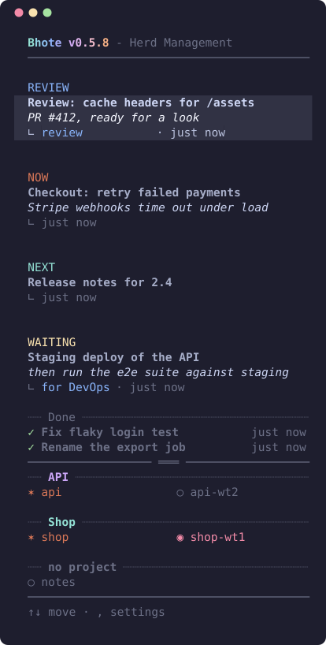

# bhote

[](https://github.com/floriankappert/bhote/actions/workflows/tests.yml)
[](https://github.com/floriankappert/bhote/releases)
[](LICENSE)

*by Florian Kappert and Jakob Beyer*

**bhote is a native add-on for the [herdr](https://herdr.dev) Mac app.** It keeps your **topics** (what you work on, who you wait for) next to your
**agents** (who is free, who is busy) on every machine you work on, and around them what you look at all day: the commits and pull requests of an agent,
the tests and deployments of your projects, the dev servers and the headless agents. herdr is a workspace for coding agents such as Claude Code and Codex;
the add-on is a mod of the herdr app with a layout of its own: its panels are drawn by the app (a settings dialog, drag and drop, transitions), it is **not a terminal UI**.

> **Since 0.9.3 the terminal UI is deprecated.** The panel that bhote drew in a herdr pane (bash and Rust) stays for machines without the app, such as Omarchy,
> and gets no new features: see [Terminal UI (deprecated)](#terminal-ui-deprecated). The CLI, the topic files and the collector are the same underneath.

## Features

**In the herdr Mac app** (details in [the add-on](docs/herdr-app.md)):

- **Overview and tabs:** tiles for topics, pull requests, deployments, tests, servers and runbooks, a tab for each, and the settings dialog in a row at the foot.
- **Topics** move through `now`, `next`, `waiting`, `review`, `later` and `done`. **Start on agent** hands a topic over as a message: a spinner runs until the agent takes it, then that agent is fixed.
- **Agents of all machines** as cards under their machine (by its alias, e.g. *Omarchy*), each with a name from Middle-earth (Frodo, Sam, Merry …). Working agents are orange, those with tests or CI running yellow,
  those that need you red, finished ones green. Drag and drop sets the order. The **ear** on a card says whether other agents may message it (`bhote send`); with it on, the agent picks the message up when it is free.
- **Commit inspector:** the last ten commits of the focused agent's branch since `main`, a click shows the whole message.
- **Pull requests, tests and deployments:** a PR's CI checks show on its agent's card with a progress bar (found by branch or by the head commit, so a local branch pushed under another name works); the Tests tab shows local runs, CI jobs
  and test processes found on any machine, the workflows of one CircleCI pipeline as one card.
- **Servers:** the IMS systems of every machine, **dev servers** you start and stop per machine (Bilendo, Marketing, any command: a start that fails turns the card red with the log and becomes a topic in review) and the SSH tunnel.
- **Headless agents:** your scheduled Claude jobs on every machine with their machine, run now, pause and stop, their log as a small conversation, and a form to start another run (machine, folder, prompt).
- **Runbooks:** per project the path of a change as stages (commit, PR, tests, merge, your deploy stages), set in the settings.
- **Settings dialog** for everything that concerns the app, with the dependencies between settings shown.

**Everywhere** (the CLI, the collector and the files, with or without the app):

- **Steal & Transfer:** an agent commits its state with a handover on its branch, and a free agent takes over ([how](docs/steal-and-transfer.md)).
- **Waiting:** agents that have to wait for someone create a waiting topic themselves (bhote skill for Claude Code); a waiting topic can carry a **Slack pin**; an agent that asks you a question gets a review topic by itself (`AUTO_REVIEW`).
- **Projects:** an agent belongs to a project by its git repository (worktrees inherit). **Deployment and test monitor:** GitHub Actions and CircleCI (with approvals), local runs through `bhote test run`, live status files.
- **Topics are plain files**, kept in sync with a second machine through herdr's own connection, or with every machine through [kharka](https://github.com/jakobbeyer/kharka) (opt-in); an update notice when a newer version is out.
- **Claude Code mod:** the topic as a band above the prompt, `/topic review|done|…`, a friendly reminder now and then.
- A **CLI** (every command with `--json`) to create and close topics and to message agents from scripts and agents.

## The engine: the collector and the Rust daemon (optional)

The add-on reads what the collector writes; the daemon is part of that engine. bhote is still one bash script and runs without anything else. Next to it there is a small Rust program, `bhoted` (`daemon/`), that
takes over what costs time in bash: agents of all machines, the topic store, the monitors, the follow-ups, building the frame, and, if you
switch it on (`BHOTED_PANEL=on`), the panel itself (keys, mouse, drawing). One daemon runs per machine; the panels and the collector start it. Without the binary, or with
`BHOTED=off`, everything runs in bash as before. Measured on a busy machine: load 10.6 down to 0.8, a frame 90 ms down to 3 ms, an idle panel 0.2 % of a core.

```text
   herdr (panes, agents)      GitHub Actions, CircleCI
            │                            │
            ▼                            ▼
   ┌──────────────────────────────────────────────┐        ┌───────────────────┐
   │  bhoted daemon (one per machine)             │  merge │      kharka       │
   │  agents · monitors · follow-ups · index      │◄──────►│ topics and agents │
   └──────────────────────┬───────────────────────┘ newer  │ of every machine  │
                          │ files, written atomically wins └───────────────────┘
                          ▼
   ┌──────────────────────────────────────────────┐
   │  topics/*.topic · agent and monitor lists ·  │◄─────────────┐
   │  topic index                                 │              │ same files
   └───────────┬──────────────────┬───────────────┘              │
               │ read             │ read                ┌────────┴─────────────┐
               ▼                  ▼                     │ bhote script (bash): │
      ┌────────────────┐ ┌────────────────┐             │ CLI, hooks, settings,│
      │ bhoted panel   │ │ bhoted panel   │ ── hands ──►│ wizard, topic page   │
      │ tab 1          │ │ tab 2          │    over     └──────────────────────┘
      └────────────────┘ └────────────────┘
```

- **Files are the interface.** A bash script cannot talk to a socket without starting a process, and a process per read is what made bhote slow.
  The daemon writes snapshots (topic index, agent and monitor lists) that panels read; the CLI and the bash views keep working on the same plain `*.topic` files.
- **The panel can be Rust, the rest stays reachable.** With `BHOTED_PANEL=on` `bhoted panel` draws the main view and handles keys and mouse; settings, the setup wizard and the topic page
  run as the script's own views on the same terminal and hand back when done.
- **It builds on every machine** (Linux and macOS, needs a Rust toolchain: `cd daemon && cargo build --release`) and is checked against the bash functions byte for byte
  (`tests/frame.sh`, `follow.sh`, `sync.sh`, `panel.py`, a fuzz test). Switches: `BHOTED`, `BHOTED_FRAME`, `BHOTED_FOLLOW`, `BHOTED_PANEL` ([configuration](docs/configuration.md)).
  The plan, the steps and the measurements are in **[docs/rust-rewrite.md](docs/rust-rewrite.md)**.

## Requirements

- **The herdr Mac app** (`herdr-app`, with its `hc`): the add-on's home. Other machines (Linux, Omarchy) join as machines: their agents, servers and headless agents show in the app, and on them bhote runs the CLI and the collector (and the terminal UI, where there is no app)
- bash 3.2 or newer (the bash that ships with macOS is enough) and `jq`
- optional: Claude Code (skills, the SessionStart hook, the Slack watch, the topic mod), `gh` or a CircleCI token (the monitors), [kharka](https://github.com/jakobbeyer/kharka) (sync between machines)

## Install

```sh
brew install floriankappert/bhote/bhote      # the CLI, the collector and the add-on files
bhote app install                            # the add-on into the herdr Mac app (~/.config/herdr-app)
bhote skills install                         # optional: the Claude Code skills bhote and bhote-install, in every Claude profile
```

Then show the layout in the app: `herdr-app do layout.show --id bhote`, or pick the layout *bhote*. `bhote app check` loads the mod once and reports what is wrong.
**Update:** `brew upgrade bhote && bhote app install` (the app reloads a changed mod by itself). From a checkout: `git clone https://github.com/floriankappert/bhote && cd bhote && ./install.sh && bhote app install`.
Arch Linux: the package in `packaging/arch` (`makepkg -si`) brings the CLI and the add-on files for a Mac to copy; there is no app on Linux, so the terminal UI is what runs there.
More in **[the add-on](docs/herdr-app.md)**.

## Quick start

Open the layout *bhote* in the herdr app. The panel on the right is your topics, the one on the left your agents. Then:

- **Add a topic** with the button at the top (`Fix the login redirect; users land on /home`), open it, **Start on agent**.
- **Message an agent** from a script or another agent: `bhote send frodo "please look at the vendor page"`; the ear on its card decides when it takes it.
- **Settings** are the row at the foot of the panel (the gear): everything that concerns the app, the runbooks of your projects and your dev servers.
- From a script or an agent:

  ```sh
  id=$(bhote add "Migrate the billing export" -d "CSV to Parquet" --json | jq -r .id)   # keep the id, not the number
  bhote wait "$id" DevOps && bhote now "$id" && bhote done "$id"
  ```

## CLI and configuration

The CLI is the API: the panel, scripts and agents all work on the same topics through it. Every command takes `--json`
(one document per call), results go to stdout, messages to stderr. Exit codes: `0` ok · `1` error · `2` the ref matches
more than one topic. `bhote help` lists every command; the **[CLI reference](docs/cli-reference.md)** has the detail.

Settings live in `~/.config/bhote/config` (`KEY=value` lines, never sourced, so a value cannot run as code). Edit them in
the panel (`,`) or with `bhote config set KEY value`; `bhote config list` shows all. Nothing that reaches another machine
is on by default. Every key is in the **[configuration reference](docs/configuration.md)**.

## Terminal UI (deprecated)

Until 0.9.2 bhote was a panel in a herdr pane: one bash script (and, with `BHOTED_PANEL=on`, a Rust program) drawing about 56 columns of cards, with a small sheepdog.
It is **deprecated since 0.9.3**: it stays for machines without the herdr Mac app (Omarchy and other Linux machines) and gets no new features; the add-on above replaces it.
Everything below is how it is installed and used.

<p align="center"></p>

### Requirements

- macOS or Linux, bash 3.2 or newer (the bash that ships with macOS is enough)
- [herdr](https://herdr.dev) and `jq`
- optional: Claude Code (skills, the SessionStart hook, the Slack watch, the 2.1.287+ topic mod), `gh` or a CircleCI token (the monitors), Omarchy (the bar widget)

### Install

**Recommended: install it, then let Claude Code finish the setup.** Two commands, then one word in a Claude Code session:

```sh
brew install floriankappert/bhote/bhote      # Arch/Omarchy and other Linux: see below
bhote skills install                         # the Claude Code skills bhote and bhote-install, in every Claude profile
```

In Claude Code: **`/bhote-install`**. The skill installs the herdr plugin, the Omarchy bar widget, the Claude hook and skills,
the settings, the connection to your other machines and the deployment and test monitor, and checks each step. (The
interactive wizard `bhote setup` does the same by hand.)

**macOS** (Homebrew):

```sh
brew install floriankappert/bhote/bhote
herdr plugin link "$(brew --prefix)/share/bhote/herdr-plugin"
```

**Arch Linux / Omarchy** (the package from `packaging/arch`; it also brings the Omarchy bar widget):

```sh
git clone https://github.com/floriankappert/bhote && cd bhote/packaging/arch && makepkg -si
herdr plugin link /usr/share/bhote/herdr-plugin
# Omarchy: the bar widget
ln -s /usr/share/bhote/omarchy-plugin ~/.config/omarchy/plugins/bhote.bar && omarchy plugin enable bhote.bar --section right
```

**Any Linux** (also Homebrew on Linux works with the command above), or from a checkout on any system:

```sh
git clone https://github.com/floriankappert/bhote && cd bhote && ./install.sh
```

`install.sh` links `~/.local/bin/bhote` to the checkout (update with `git pull`) and, when herdr is present, the plugin
`bhote.panel`, which opens the panel on the right of the agent pane of every tab when herdr starts (`AUTOSTART=off` in the
config switches that off; the action "Bhote: open panel" opens it by hand). On Omarchy it also links the bar widget
`bhote.bar`: the number of things for you (topics in review, agents that need an answer), the list on hover, a click jumps
to the bhote panel in herdr (right click: the search). `bhote bar` prints the same as Waybar-style JSON for any other bar.

After an update, `bhote reload` restarts the panels of the machine (never type into a running panel: keys act as hotkeys there).

### Quick start

Start herdr; the panel opens next to the agent pane of each tab (or run `bhote` in any pane). The first start shows the
setup wizard. Then:

- `n` adds a topic (`Fix the login redirect; users land on /home`), click one, `s` starts it on a free agent.
- `x` checks it off, `→` opens its page with every action, `,` opens the settings.
- From a script or an agent:

  ```sh
  id=$(bhote add "Migrate the billing export" -d "CSV to Parquet" --json | jq -r .id)   # keep the id, not the number
  bhote wait "$id" DevOps && bhote now "$id" && bhote done "$id"
  ```

### Keys

| key | does |
|---|---|
| click | a card: show its agent in herdr; a double click, and a click on a line (next, waiting, later, done): the topic's page |
| `→`, `←` / `esc` | the topic's page / go back |
| `n` | new topic: `Title`, `Title; description`, optionally ending in `@Name` or `> Name` (= waiting for Name) |
| `s` | start the topic on a free agent |
| `t` | Steal & Transfer to another agent |
| `e` / `d` | edit the title / the description (Esc cancels) |
| `x` | mark done |
| `a` | topics suggested from what the running agents work on |
| `,` | settings · `S` welcome screen · `w` the new wizard steps · `q` quit |
| click a topic | select it (any of its lines; the list does not scroll while it is in view); a double click opens its page, where a click runs an action or edits the title or description |
| click an agent | focus it in herdr (on another machine: on a Mac with `AGENTS_VIA=kharka` herdr switches to it; otherwise selected there, and the panel says which keys switch to it) |
| find key (e.g. `ctrl+alt+t`, ⌘T) | search all agents and topics, jump there (`bhote find` as a herdr popup) |
| herdr prefix, `t` | jump from the agent to the panel and back (the plugin action `bhote.panel.focus`; the keys are shown bottom right) |

The full list is in [the panel](docs/panel.md).

## Data and safety

Topics live in `${XDG_DATA_HOME:-~/.local/share}/bhote/topics` (one small file per topic). With a replica machine (or
kharka, `STORE=kharka`), the local copy stays the working copy; the newer `updated` wins per topic, deletions travel as tombstones, and while the
machine is not reachable bhote works offline and merges later ([data and sync](docs/data-and-sync.md)).

bhote opens no connection to another machine unless you switch it on. Names that arrive from a replica are validated before
they become files; control characters are stripped from everything shown or sent; scratch and shared folders are private
(0700); one panel per machine collects agent data, the others read its result. To report a vulnerability, see
[SECURITY.md](SECURITY.md).

## Troubleshooting

- **The add-on does not show:** `bhote app check` must say `check passed`; `herdr-app status` shows errors of the app; show the layout with `herdr-app do layout.show --id bhote`.
- **A change of the mod does not show:** `bhote app install` copies the files again; the app reloads a changed mod by itself.
- **Something is missing:** `bhote setup --json` lists what is installed and what is not (herdr plugin, Claude hook,
  machines); `/bhote-install` in Claude Code repairs it.
- **No panel opens:** `herdr plugin list` must show `bhote.panel`; `AUTOSTART=off` keeps it closed; a tab narrower than
  the panel plus 64 columns for the agent gets none (open it by hand with the action "Bhote: open panel").
- **No agents are listed:** `bhote agents` shows what herdr reports; agents of other machines need `REMOTE_AGENTS=on`
  and a saved herdr machine, or `AGENTS_VIA=kharka` and herdr-kharka on that machine.
- **The panel shows an old version after an update:** `bhote reload`.
- **`bhote: ... jq`:** install `jq` (`brew install jq`, `pacman -S jq`, `apt install jq`).

## Uninstall

```sh
rm -r ~/.config/herdr-app/mods/bhote ~/.config/herdr-app/layouts/bhote.json   # the add-on (the layout, the mod)
herdr plugin unlink bhote.panel                       # every install
brew uninstall bhote                                  # Homebrew
sudo pacman -R bhote                                  # Arch
rm ~/.local/bin/bhote                                 # install.sh
rm ~/.config/omarchy/plugins/bhote.bar                # Omarchy bar widget (install.sh)
```

Your topics and settings stay until you remove them: `~/.config/bhote` and `${XDG_DATA_HOME:-~/.local/share}/bhote`.
Claude Code: `bhote mod remove` (the mod), delete `skills/bhote` and `skills/bhote-install` in each Claude profile (`~/.claude`, …) and the
`bhote current` entry under `hooks.SessionStart` in its `settings.json`.

## Contributing

Bug reports, ideas and pull requests are welcome; see [CONTRIBUTING.md](CONTRIBUTING.md) for the development setup, the
tests and the few rules the script lives by (bash 3.2, nothing leaves the machine by default). Please follow the
[code of conduct](CODE_OF_CONDUCT.md). Questions: [SUPPORT.md](SUPPORT.md).

## License

MIT, see [LICENSE](LICENSE). Documentation: [docs/](docs/README.md), starting with the [CLI reference](docs/cli-reference.md).
